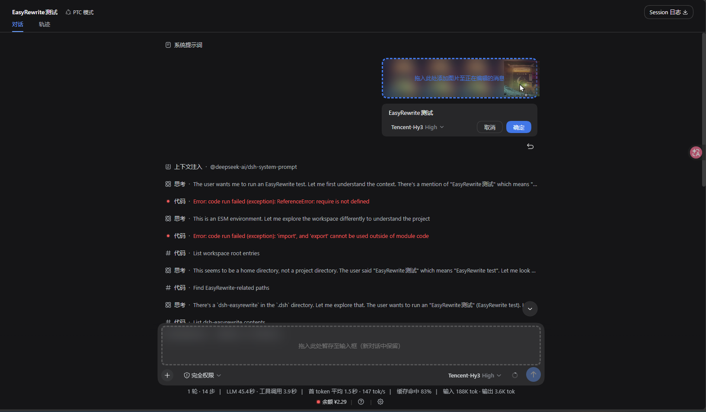
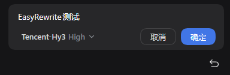
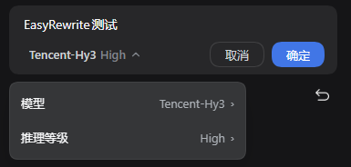
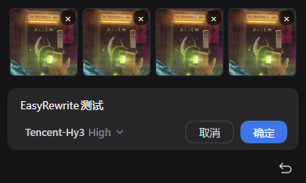
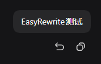
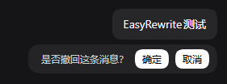
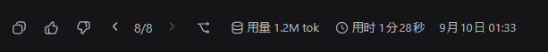
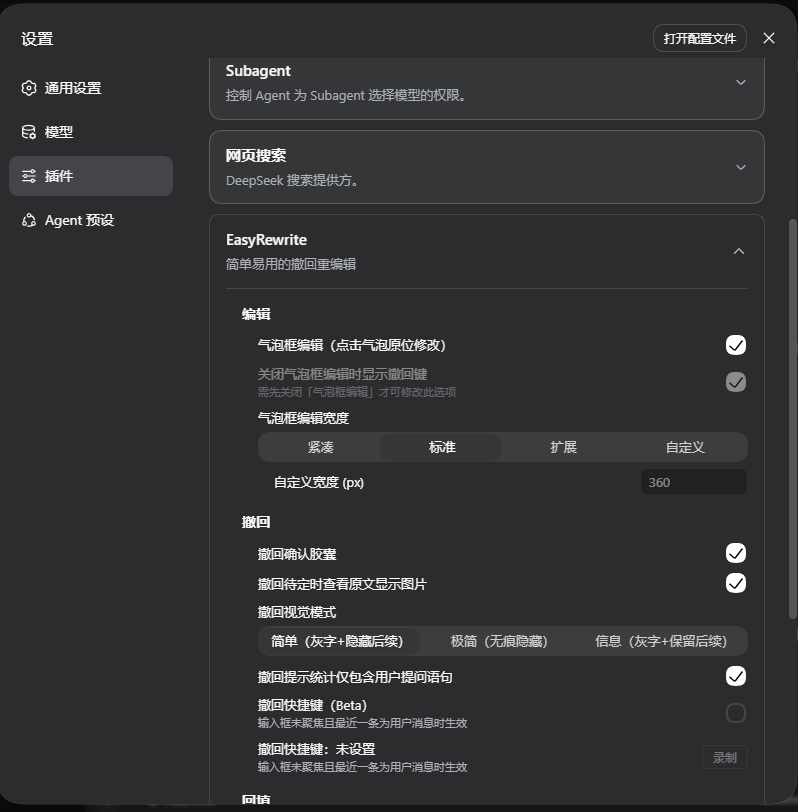
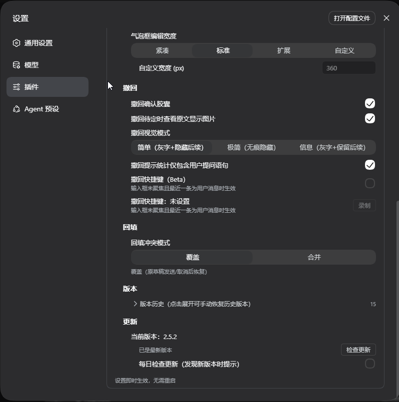

<div align="center">
<picture>
<source media="(prefers-color-scheme: dark)" srcset="https://raw.githubusercontent.com/Renzic-Stone/DSH-EasyRewrite/main/assets/logo-dark.png" />

</picture>

# DSH-EasyRewrite

[中文](README.md) | [日本語](README.ja.md)

<a href="https://www.npmjs.com/package/dsh-easyrewrite"></a> <a href="https://github.com/Renzic-Stone/DSH-EasyRewrite/blob/main/LICENSE"></a> <a href="https://github.com/Renzic-Stone/DSH-EasyRewrite/stargazers"></a> <a href="https://www.npmjs.com/package/dsh-easyrewrite"></a> <a href="https://dshfind.com/en/plugins/Renzic-Stone/DSH-EasyRewrite?ref=badge"></a>

`#dsh` `#deepseek-harness` `#recall` `#rewrite` `#bubble-edit` `#version-pager` `#i18n` `#multilingual`

</div>

**Inline-edit & recall your own user messages in the DeepSeek Harness Web UI — lightweight, native-styled, and effective the moment you confirm. Recall only deletes; edit deletes and replaces with a new message.**

Click your own message bubble to edit it in place: confirming truncates the conversation and sends the revised text as a new message. Hit the recall button beside copy and confirm in the inline capsule to immediately delete that message and everything after it, then open the truncated new session — nothing new is sent. Cancelling before confirm leaves the conversation and the composer completely untouched.

> Compatible with DeepSeek Harness Web (**v2.6.0 fully supports both dsh 0.1.7-rc.1+ and 0.1.2-rc.1+**; users on dsh 0.1.1-rc.2 and older hosts, please stay on **2.3.1** — the final release of that line, fully functional, no further features). Built on official extension points only — no source patches.

---

## 📸 Visual Tour

<div align="center">
  
  <p><em>✨ <b>Dual-dropzone & synchronized 2.5x expansion</b>: smart drag-and-drop dispatch (drop onto the bubble to add images to current edit, or drop into the 2.5x expanded bottom composer to stage for new sessions — strictly isolated with zero leakage)</em></p>
</div>

---

## Quick Start

```sh
# One-line install via npm
dsh plugin --profile web add dsh-easyrewrite
```

## Features (what we've built)

### Bubble Inline Edit (Rewrite) — Shipped (M2/M4)
- **Click to edit**: Click your message bubble to enter inline editing directly (original Markdown source preserved), Esc to cancel / Ctrl+Enter to confirm.
- **Adjustable width modes**: Compact (starts at bubble width) / Standard (fits the content, never narrower than the action buttons) / Expanded (full message width) / Custom. All modes are capped at 80% of the message content width and grow with the text, with smooth inner scrolling.
- **On-the-spot model & effort switching**: Native dropdown menu embedded inside the bubble editor allows instant switching of provider, model, and reasoning effort for the resend.
- **Rich image support & drag-drop management**: Multi-image messages render in equal-width thumbnail strips, supporting individual `×` deletion, clipboard paste, and drag-and-drop addition. Edits survive tab switching and page reloads.
- **Confirm to resend**: Confirming truncates at the closed-turn boundary before the target message and sends the revised text as a new message; the original session is archived and the new one opens.

<div align="center">
  
  &nbsp;&nbsp;
  
</div>
<div align="center" style="margin-top: 8px;">
  
</div>

<br>

### Message Recall (撤回) — Done, End to End
- **Native & frictionless action**: Permanent recall button placed cleanly next to the official copy button on hover.
- **Inline confirmation capsule**: Native-styled capsule (`撤回这条消息及其后 x 条提问？` + Confirm / Cancel pills), calculating the exact count of subsequent user prompts to be deleted in real time (0 shows "是否撤回这条消息？"); with the confirmation toggle off, clicking the button executes recall directly.
- **Confirm to delete**: Pressing Confirm immediately removes that message and everything after it — the session is forked at the closed-turn boundary before the target, the original is archived, and the truncated new session opens. No new message is sent and the composer is left untouched.
- **First message works too**: With no earlier closed-turn boundary, the current session is archived and a blank new session opens — again, nothing is sent automatically.
- **Seamless session switch**: The original session is archived and the truncated new one takes over. A still-open turn shows a wait hint until the reply finishes.

<div align="center">
  
  &nbsp;&nbsp;
  
</div>

<br>

### Version Pager (< X >) — Shipped (M3)
- **Seamless history version navigation**: The **`‹ X/N ›`** control is embedded directly inside the action strip of the final reply after every edit resend (new versions come from edit resends).
- **Context synchronization**: Clicking arrows (or pressing ←/→ keys) toggles the target branch, and **all subsequent dialogue context automatically syncs with the active version**.
- **Archive swap & smooth viewport anchoring**: The workspace list keeps only one active session at any time, while the chat viewport stays rock-solid without jumping.

<div align="center">
  
</div>

<br>

### Settings & Customization — Shipped (M3/M4)
- **Integrated settings card**: Integrates into **Settings → Plugins → EasyRewrite** with native design tokens and automatic trilingual localization (中文 / English / 日本語).
- **Rich toggles & fine-grained control**:
  - Bubble edit toggle & fallback recall button
  - Bubble editor width presets (Compact / Standard / Expanded / Custom)
  - Recall confirmation capsule toggle & "count only user prompts" statistic option
  - Customizable shortcut recording (trigger recall with one keystroke when composer is unfocused)
  - Full version history tree explorer with manual restoration
  - Built-in one-click plugin update check & auto-upgrade

<div align="center">
  
  &nbsp;&nbsp;
  
</div>

<br>

---

## How we differ from similar plugins

| Capability | dsh-easyrewrite | Other recall/edit plugins |
| :--- | :---: | :--- |
| Recall | ✅ | Basic capability |
| **Confirm-to-delete** (pressing Confirm immediately removes that message and everything after it, without sending anything new) | ✅ | Most competitors add an extra send or more steps |
| **Seamless session switch** (original session archived, truncated new session opened after edit resend / recall) | ✅ | Basic capability, but ours is **more refined** |
| **Zero change before confirm** (cancelling the capsule or an edit leaves session, context and composer untouched) | ✅ | Some competitors edit immediately, causing cache-hit / context issues |
| **Bubble inline edit (Rewrite)** | ✅ | **No comparable feature in any competitor** |
| **Version pager < X >** (switch history versions produced by edit resends — a **gold-standard design** proven by countless Chatbox users) | ✅ | **No comparable feature in any competitor** |
| **Edit draft kept per session** (progress resumes after switching chats or reloading) | ✅ | **No comparable feature in any competitor** |
| **Attachment-preserving edit resend** | ✅ | No comparable feature in any competitor |
| **Official extension points only** (zero source patches, clean uninstall) | ✅ | Competitors rely on source patches — hard to uninstall, complex dependencies |
| Trilingual UI & i18n | ✅ | Few have proper i18n; we natively support multiple languages with three presets |
| **Every feature can be toggled off** | ✅ | **No competitor does it better** |

---

## Design philosophy

**1. Simple to use, easy to onboard, compatible by contract**

- Interactions need no manual: **click the bubble to edit, recall key sits beside copy** — no new concepts, no new entry points.
- Sensible defaults: the default settings are the right choice for most scenarios; install, restart, done.
- Compatibility is a hard promise: only official extension points (keyed slot override, official `sessions.fork` RPC, official components & design tokens) — **no source patches, no brittle internal APIs**, actively adapted across DSH releases.
- Uninstall restores everything; nothing of your install is left behind.

**2. Faithful to the original experience — seamless & invisible**

- UI language follows dsh's native design (grey-blue palette, rounded corners, pills, official icons), dark/light theme aware — feels like an official feature, not "another plugin skin".
- Original interactions stay intact: copy key, hover timestamps, bubble look — all preserved.
- **Invisible**: day-to-day use barely notices the plugin — features live where you expect them, results match intuition; no popups, no interrupted rhythm.
- **Effective on confirm**: recall deletes immediately when you press Confirm in the inline capsule; edit resends immediately when you press Confirm. Until then — or after Cancel/Esc — the session, model context and composer stay untouched. They are independent: **recall only deletes, edit deletes and replaces with a new message**.
- **Seamless switch**: after a recall the original session is archived and the truncated new one takes over — no "a new conversation appeared" split. Nothing is sent automatically; just type to continue whenever you like.
- **Bubble edit (landing soon)**: click the bubble to edit in place, what you edit is what you send — the natural extension of the same seamless philosophy.

**3. Edit draft kept, accident-proof**

- Edit drafts are **kept per session**: switching chats, refreshing, even restarting dsh — progress resumes where you left it. No "lost half-written" moments.
- Recall has no pending state before confirm: pressing Cancel or dismissing the capsule leaves the session and composer exactly as they were.
- Every key step has a confirm and a cancel path: confirmation capsule, Esc/Cancel — **mistakes are recoverable, data is never lost**.

**4. Complete logging, fast diagnosis**

- Every client step (load, confirm, truncation, fork, opening the new session, resume) is reported to the host and written to a unified log: `$DSH_HOME/dsh-easyrewrite.log`.
- Uniform format (JSON lines: time / level / tag / message / data) — one reproduction is enough to locate the issue, no back-and-forth descriptions.
- Host behaviour lands in the same log (requests, rejection reasons, exceptions), so both halves reconcile on one trail.
- Logs stay local; nothing is uploaded.

**5. Continuously updated, actively compatible**

- Follows DSH releases (rc.x → stable); upstream API changes are adapted promptly.
- Semantic versioning + CHANGELOG; breaking changes announced in advance.
- Community-driven: issues and PRs answered, new ideas and scenarios folded into the roadmap.

---

## Install

```sh
# npm (published)
dsh plugin --profile web add dsh-easyrewrite
# or from GitHub
dsh plugin --profile web add github:Renzic-Stone/DSH-EasyRewrite
```

Restart `dsh web`, hard-refresh (`Ctrl+Shift+R`), done.

> A note on **when recall works**: DSH forks only at closed-turn boundaries, so a message inside a still-open turn cannot be truncated yet — wait for the reply to finish, then recall. (The UI tells you: `该消息所在回合尚未结束…`)

---

## Debugging

Every client step is reported to the host and written to a unified log:

```
$DSH_HOME/dsh-easyrewrite.log   # e.g. ~/.dsh/dsh-easyrewrite.log
```

JSON lines: `{ t, level, tag, message, data }`.

---

## Structure

```
dsh-easyrewrite/
├── lib/index.js          # host half: update check + pnpm up (only two routes left)
├── src/client.src.js     # client half (icons are inline SVG, coloured via currentColor)
├── build.mjs             # src → lib (plain copy, no bitmap inlining)
├── DESIGN.md             # full interaction design (v1.0, 20 product decisions)
├── PROJECT_PLAN.md       # roadmap, architecture, git workflow
└── docs/                 # api-facts, m0-verify
```

---

## License

MIT
