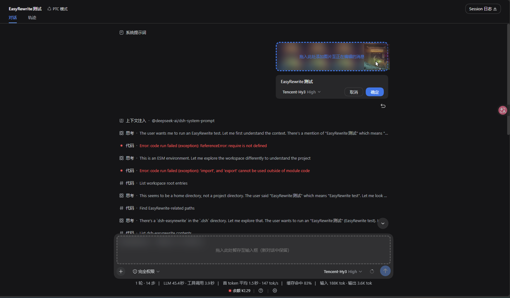
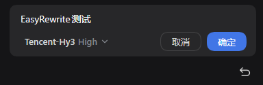
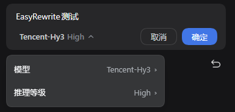
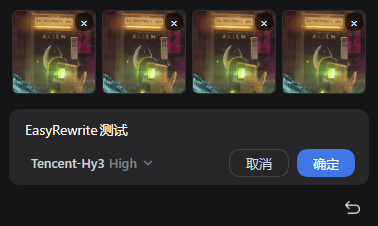
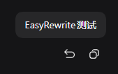
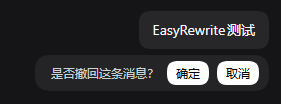
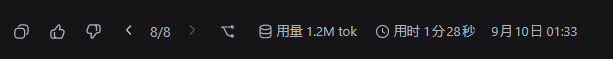
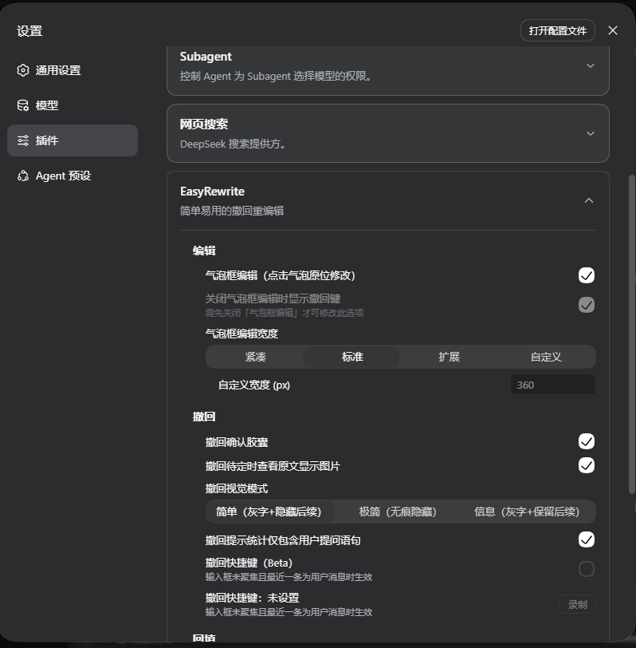
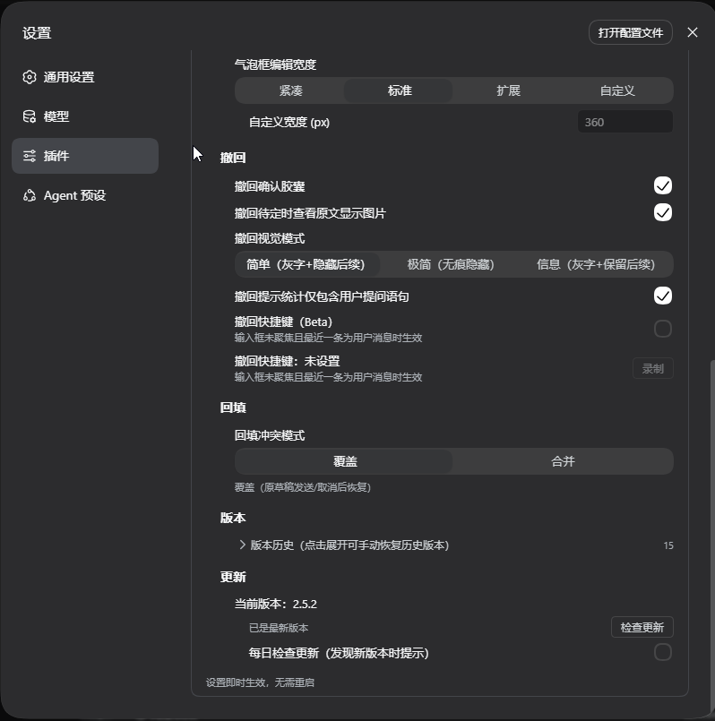

<div align="center">
<picture>
<source media="(prefers-color-scheme: dark)" srcset="https://raw.githubusercontent.com/Renzic-Stone/DSH-EasyRewrite/main/assets/logo-dark.png" />

</picture>

# DSH-EasyRewrite

[English](README.en.md) | [日本語](README.ja.md)

<a href="https://www.npmjs.com/package/dsh-easyrewrite"></a> <a href="https://github.com/Renzic-Stone/DSH-EasyRewrite/blob/main/LICENSE"></a> <a href="https://github.com/Renzic-Stone/DSH-EasyRewrite/stargazers"></a> <a href="https://www.npmjs.com/package/dsh-easyrewrite"></a> <a href="https://dshfind.com/zh/plugins/Renzic-Stone/DSH-EasyRewrite?ref=badge"></a>

`#dsh` `#deepseek-harness` `#撤回` `#气泡编辑` `#重编辑` `#版本翻页器` `#i18n` `#多语言`

**在 DeepSeek Harness Web 里用气泡编辑与撤回键轻松整理已发出的消息——轻量、原版风格、确认即生效。撤回只删除，编辑删除并替换成新消息。**

单击自己的消息气泡即可原位编辑，确定后截断并把修改稿作为新消息自动发出；点击复制键旁的撤回键、在行内胶囊里点「确定」，立即删除该消息及其后的所有消息，打开截断后的新会话，不发送任何新内容。确认前取消，会话与输入框完全不变。

> 兼容 DeepSeek Harness Web（**v2.6.0 全面适配 dsh 0.1.7-rc.1+ 与 0.1.2-rc.1+ 双代版本**；0.1.1-rc.2 及更早宿主用户请停留 **2.3.1**——该线最终版，功能完整可用，仅不再追加新功能）。纯官方扩展点实现，不改 DSH 源码。

</div>

---

## 📸 界面一览 / Visual Tour

<div align="center">
  
  <p><em>✨ <b>独创双区拖拽与协同舒展</b>：气泡编辑拖入文件智能分流（释放到上方气泡添加至正在编辑的消息，释放到底部 2.5x 平滑放大的输入框暂存新对话，双区隔离零串发）</em></p>
</div>

---

## 快速开始

```sh
# npm一键安装
dsh plugin --profile web add dsh-easyrewrite
```

## 已实现功能

### 气泡原位编辑（Rewrite）——已实现（M2/M4）
- **点击即改**：单击自己的消息气泡直接进入原位编辑态（保留原始 Markdown 原文），Esc 取消 / Ctrl+Enter 确定。
- **四档编辑宽度**：紧凑（气泡原宽起步）/ 标准（贴合内容，短文本不小于按钮行）/ 扩展（顶满消息行）/ 自定义；所有档位上限为消息内容宽的 80%，输入时随内容增高并支持内部平滑滚动。
- **模型与推理等级就地切换**：编辑框内原生集成模型选择下拉菜单，可直接切换当前消息的重发模型与推理深度（Reasoning Effort）。
- **图片消息完整编辑与拖拽增删**：多图消息等宽缩略行排布，支持独立 `×` 删除、剪贴板粘贴与拖入新增，刷新后编辑进度原样恢复。
- **确定即重发**：点「确定」后截断到该消息之前的闭合回合边界，把修改稿作为新消息自动发出，原会话归档、新会话打开。

<div align="center">
  
  &nbsp;&nbsp;
  
</div>
<div align="center" style="margin-top: 8px;">
  
</div>

<br>

### 撤回（Recall）——端到端完成
- **操作无感原生**：每条用户消息的官方复制键旁常驻撤回键，鼠标悬停即现。
- **行内确认胶囊**：dsh 官方同款极简灰白胶囊（`撤回这条消息及其后 x 条提问？` + 「确定/取消」），实时动态统计将撤回的问题数（0 条时显示「是否撤回这条消息？」）；确认开关关掉时点键直接执行。
- **确认即删除**：点「确定」立即把这条消息及其后全部消息从会话中删除——fork 到该消息之前的闭合回合边界、归档原会话、打开截断后的新会话；不发送任何新消息，也不改动输入框。
- **会话第一条也能撤回**：没有前置闭合边界时，归档当前会话并打开空白新会话，同样不自动发送任何内容。
- **无缝会话切换**：原会话自动归档，截断后的新会话无缝顶替；未结束的回合提示等待回复完成后再撤回。

<div align="center">
  
  &nbsp;&nbsp;
  
</div>

<br>

### 版本翻页器（< X >）——已实现（M3）
- **多版本无缝切换**：每次编辑重发后，该次问询最后回答的操作区自动嵌入 **`‹ X/N ›`** 原生风格翻页器（由编辑重发产生的新版本回答形成）。
- **上下文联动**：点击箭头（或键盘 ←/→）切换分支版本，**后续整个上下文自动跟随版本变动刷新**。
- **视口锚定与归档交换**：切换时视口平滑锚定不跳位，列表始终只保留一个活动会话，全归档版本亦可在设置中随时恢复。

<div align="center">
  
</div>

<br>

### 设置中心与个性化定制（Settings）——已实现（M3/M4）
- **官方同款折叠配置卡片**：无缝融入 **设置 → 插件 → EasyRewrite**，界面语言随系统自动同步（中文 / English / 日本語）。
- **丰富细致的选项**：
  - 气泡框编辑总开关、关闭气泡编辑时备用撤回键
  - 编辑宽度（紧凑 / 标准 / 扩展 / 自定义）
  - 撤回确认胶囊开关、撤回提示统计仅包含用户提问语句
  - 撤回快捷键录制（未聚焦输入框时一键发起撤回最近一条消息）
  - 版本历史树浏览与一键手动恢复
  - 插件内置自更新检测与一键升级

<div align="center">
  
  &nbsp;&nbsp;
  
</div>

<br>

---

## 与同类插件的差异

| 能力 | dsh-easyrewrite | 其他撤回/编辑类插件 |
| :--- | :---: | :--- |
| 撤回（Recall） | ✅ | 基本功能 |
| **确认即删除**（点确定立即移除该消息及其后全部消息，不发送任何新内容） | ✅ | 多数竞品附带额外发送或多余步骤 |
| **无缝会话切换**（编辑重发与撤回截断后自动归档原会话、打开新会话） | ✅ | 基本功能，但我们**做的更完善** |
| **确认前零改动**（取消确认胶囊或编辑，会话、context、输入框原样不动） | ✅ | 部分竞品直接改动，导致各种缓存命中/context问题 |
| **气泡原位编辑**（Rewrite） | ✅ | **目前市面竞品完全无同类功能** |
| **版本翻页器 < X >**（切换编辑重发产生的历史版本，无数Chatbox验证过的**黄金设计**） | ✅ | **目前市面竞品完全无同类功能** |
| **编辑草稿按会话保留**（切对话、刷新后编辑进度原样接续） | ✅ | **目前市面竞品完全无同类功能** |
| **编辑重发保留图片附件** | ✅ | 目前市面竞品完全无同类功能 |
| **纯官方扩展点**（零源码补丁，卸载即还原） | ✅ | 竞品依赖源码补丁，卸载困难，依赖复杂 |
| 三语界面与 i18n 支持 | ✅ | 几乎没有完善的i18n支持，我们原生支持多语言和预设三语 |
| **全部功能可按需开关** | ✅ | **目前市面竞品完全没有比我们做得好的** |

---

## 设计哲学

**1. 简单易用，易上手，兼容性好（Simple & Compatible）**

- 交互直观到不需要说明书：**点击气泡就编辑，复制键旁就撤回**——不引入任何新概念、新入口。
- 默认即合理：默认设置就是大多数场景的最优解，装完即用，无需配置。
- 兼容性是硬承诺：只使用官方扩展点（keyed 槽覆盖、官方 fork RPC、官方组件与设计令牌），**不碰源码、不依赖易碎内部 API**；DSH 升级换代时主动适配，绝不拿"改了你的安装"换功能。
- 卸载即还原：不留配置残留、不改动任何官方文件。

**2. 还原原版体验，无痕、无感（Faithful, Seamless & Invisible）**

- 界面语言完全沿用 dsh 原生风格（灰蓝配色、圆角、胶囊、官方图标），深/浅主题自适应——像官方功能，不是"又一个插件皮肤"。
- 原有交互原样保留：复制键、hover 发送时间、气泡外观——一个都不少。
- **无感**：日常使用几乎感觉不到插件的存在——该有的功能都在它该在的位置，按下去的结果就是直觉预期；不弹窗打扰、不打断节奏。
- **确认即生效**：撤回在行内胶囊点「确定」后立即删除，编辑在点「确定」后立即重发；取消或 Esc 之前，会话、模型上下文、输入框都不变。两者相互独立：**撤回只删除，编辑删除并替换成新消息**。
- **无缝切换**：撤回之后，原会话归档、截断后的新会话顶替，没有"冒出一个新对话"的割裂感；不自动发送任何内容，想接着聊直接输入即可。
- **气泡框编辑（即将上线）**：点击气泡即原位编辑、所见即所改——同一套无痕哲学的自然延伸。

**3. 编辑草稿保留，防手误零丢失（Persistent & Accident-proof）**

- 编辑草稿**按会话保留**：切对话、刷新页面、重启 dsh，编辑进度原样接续，不存在"写一半没了"。
- 撤回确认前没有任何待定状态：点「取消」或关掉确认胶囊，会话与输入框原样不动。
- 每一步关键操作都有确认与取消路径：确认胶囊、Esc/取消——**手误可撤回，数据不损失**。

**4. 完善日志体系（Log Everything, Diagnose Fast）**

- 全链路打点：client 的每个关键步骤（加载、确认、截断、fork、打开新会话、resume）自动上报 host，统一写入 `$DSH_HOME/dsh-easyrewrite.log`。
- 统一格式（JSON 行：时间 / 级别 / 标签 / 消息 / 数据），一次复现即可定位，**不用你反复描述问题**。
- host 自身行为同样落盘（请求、拒绝原因、异常），前后端一条链路可对账。
- 日志只记录本地行为，不上传任何数据。

**5. 持续更新，积极兼容（Keep Moving）**

- 跟随 DSH 版本迭代（rc.x → 正式版），上游 API 变化第一时间适配。
- 语义化版本 + CHANGELOG，每次改动可追溯；破坏性变更提前声明。
- 社区驱动：issue / PR 积极响应，新点子、新场景持续并入路线图。

---

## 安装

```sh
# npm 已发布（推荐）
dsh plugin --profile web add dsh-easyrewrite
# 或从 GitHub
dsh plugin --profile web add github:Renzic-Stone/DSH-EasyRewrite
```

重启 `dsh web`，页面 `Ctrl+Shift+R` 硬刷新即可。

> **撤回时机说明**：DSH 的 fork 只能在闭合回合边界截断，未结束回合内的消息暂时无法撤回——等回复完成后即可。（界面会提示「该消息所在回合尚未结束…」）

---

## 调试

client 每一步都会上报 host 并写入统一日志：

```
$DSH_HOME/dsh-easyrewrite.log   # 例如 ~/.dsh/dsh-easyrewrite.log
```

JSON 行格式：`{ t, level, tag, message, data }`。

---

## 项目结构

```
dsh-easyrewrite/
├── lib/index.js          # host half：更新检查 + pnpm up（仅剩两条路由）
├── src/client.src.js     # client 半边（图标为内联 SVG，随主题 currentColor）
├── build.mjs             # src → lib（纯拷贝，不再内联位图）
├── DESIGN.md             # 完整交互设计（v1.0，20 项产品决策）
├── PROJECT_PLAN.md       # 路线图、架构、git 工作流
└── docs/                 # api-facts、m0-verify
```

---

## License

MIT
